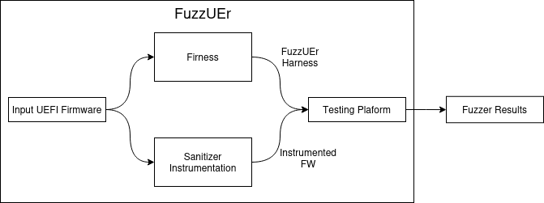

# FuzzUEr

FuzzUEr generates a UEFI harness for an EDK2 tree, builds that tree's OVMF with
AddressSanitizer, fuzzes the protocol and SMI handlers behind it, and triages what reports.
It ships as a GitHub Action so an edk2 project can run that in its own CI, and as a set of
scripts for doing the same thing at a terminal. The fuzzing backend is either
[TSFFS](https://github.com/intel/tsffs) on Simics or LibAFL-QEMU; the action always uses
QEMU.

## Read this before adopting it

This is not a badge to add to a repository on a whim. It is an action for a project that
already runs firmware CI on machines it controls.

- **It needs a dedicated self-hosted Linux x64 runner.** A hosted runner has neither the
  disk nor the job time for it. There is no hosted path.
- **The first run on a cold machine is hours, not minutes.** It builds LLVM 15 from source,
  installs Intel Simics and builds a QEMU through libafl. Later runs cost seconds, because
  every bootstrap step checks for its own output before doing anything.
- **The first checkout is a ~24 GB fetch**, and the machine wants ~100 GB free.
- **It builds exactly one platform.** OVMF X64, from `OvmfPkg/OvmfPkgX64.dsc` at
  `-a X64 -t CLANGSAN`. No other DSC, architecture or toolchain is built, whatever else your
  tree ships. If your branch's `OvmfPkgX64.dsc` does not build, there is nothing here to
  fuzz.
- **It writes to your repository by default.** `open-issues` defaults to `true`: a candidate
  triage attributes to firmware code is filed as an issue in the repository whose tree was
  fuzzed, and a `fuzzuer-evidence` branch is pushed there for those issues to link into. So
  the job needs `permissions: {issues: write, contents: write}`, and a token that can only
  read will fuzz, report, and then fail to file in a step log while the job stays green. Set
  `open-issues: false` to leave findings in the artifact only.
- **A finding is a candidate, not a defect.** `results/findings.md` is the triage of one
  sweep: **four** reports were defects in EDK2, and **one class of 24** was not -- unrelated
  modules all reporting the same faulting address, which turned out to be the harness's own
  argument buffer. `fail-on-findings` is off by default for that reason.
  [SECURITY.md](SECURITY.md) says what a candidate is and is not.
- **A full sweep of one tree is most of a working day.** Measured: 6.5 to 11.5 hours,
  depending on parallelism. There is a `qualify-only` mode that is about eight minutes, and
  it is what you should run first.

If any of that is a surprise rather than a cost you were expecting, this is the wrong tool
for the job you have.

## Requirements

| | | why |
|---|---|---|
| runner | self-hosted, Linux x64, labelled `self-hosted, linux, x64` | nothing else is built or tested. `scripts/setup_gh_runner.sh` registers one with those labels |
| dedicated to this | one sweep, not shared with other jobs | campaigns compete for the box with each other already; the driver's boot timeout scales with `jobs` for that reason, and a campaign reporting zero executions is usually contention rather than a broken harness |
| Docker | a daemon this user can talk to | every build and every campaign is a container. The user must be in the `docker` group; `checks.yml` fails the run on `docker version` rather than letting a sweep discover it an hour in |
| `sudo` | once, at runner registration | `setup_gh_runner.sh` installs the runner as a systemd service. Without sudo it registers and then has no service, which looks like total failure |
| cores | 16 or more | nothing enforces a count. `jobs` defaults to a quarter of the cores with a floor of 4, and `cores` (per firmware build) to a quarter capped at 8 -- below 16 the defaults stop telling machines apart. Every measurement in this README is from a 72-core runner |
| RAM | ~2 GiB per concurrent campaign, and a bootstrap peak | each campaign boots one QEMU at `FIRNESS_MEMORY`, default 2048 MB, so the default `jobs` on a 72-core box is 18 guests and ~36 GiB of guest memory alone. The bootstrap is the other peak: it builds LLVM 15 at `NJOBS=$(nproc)` and clang/lld link steps want roughly 2 GB each, so set `NJOBS` lower on a smaller box rather than meeting the OOM killer |
| disk | ~100 GB free | breakdown below |
| first run | hours | LLVM 15 from source, the Simics packages, and QEMU through libafl |
| `python3`, `git` | on the runner itself | the action runs `scripts/fuzz_edk2.py` directly, not inside a container. Standard library only; nothing to `pip install` |
| an Intel Simics licence | only for the Simics/TSFFS backend | the action never starts Simics -- it fuzzes under QEMU -- but the base image installs Simics anyway and there is no build flag to skip it. See [THIRD-PARTY.md](THIRD-PARTY.md) |

Where the ~100 GB goes, measured on this runner rather than estimated:

| | |
|---|---|
| the recursive clone | ~24 GB. edk2 vendors OpenSSL, which vendors its own corpora |
| `fuzzuer-base` (LLVM 15 and Simics) | 26.5 GB |
| `fuzzuer-ci` and `fuzzuer-fuzzer` on top of it | ~4 GB more; most layers are shared with the base |
| one campaign image **per ref fuzzed** | ~2.5 GB each on top of `fuzzuer-ci` |
| a run's worktree, build output and results | single-digit GB |

This README used to say ~100 GB in one place and ~60 GB in another. Neither was wrong: 60 GB
was the Docker side once the clone existed. Budget 100 GB, and expect Docker to hold
considerably more than that over time -- campaign containers are removed as they finish, but
rebuilt images leave untagged layers behind that only `docker image prune` clears.

### Register the runner where the job runs

A repository-scoped runner serves **only** that repository. One registered against the
FuzzUEr repository will not pick up a job in your edk2 repository: the job sits in `Queued`,
nothing explains why, and there is no failed run to notice. Pass the repository URL
explicitly:

```bash
scripts/setup_gh_runner.sh <registration-token> https://github.com/acme/edk2-platform
```

An **organisation** URL (`https://github.com/<org>`, no repository) registers one runner for
every repository in the org, which is usually what you want for more than one edk2 tree. One
extra step comes with it: org runners belong to a runner group, and a group can be limited to
selected repositories, with the same silent `Queued` as the symptom. Check Organisation
Settings -> Actions -> Runner groups.

Either way, confirm `Settings -> Actions -> Runners` shows one **idle** before trusting a
schedule. A workflow with no runner never starts and leaves no failed run behind.

## Quickstart

### In your own edk2 repository

[`examples/fuzzuer.yml`](examples/fuzzuer.yml) is a complete working workflow -- dispatch
inputs, a weekly schedule, the artifact upload and a job summary. Copy it into
`.github/workflows/`, change the `repository:` to wherever FuzzUEr lives, and run it once by
hand with `qualify_only` on. Cut down to the parts that matter:

```yaml
permissions:
  issues: write       # the action files findings here
  contents: write     # and pushes the fuzzuer-evidence branch they link into

jobs:
  fuzz:
    runs-on: [self-hosted, linux, x64]
    timeout-minutes: 720
    steps:
      - uses: actions/checkout@v4            # your tree
        with: {path: edk2, fetch-depth: 0}
      - uses: actions/checkout@v4            # FuzzUEr, with its submodules
        with: {repository: <you>/FuzzUEr, path: fuzzuer, submodules: true, fetch-depth: 0}
      - id: fuzz
        uses: ./fuzzuer
        with:
          source: edk2
          qualify-only: true                 # every stage except the fuzzing: ~8 minutes
      - if: always()
        uses: actions/upload-artifact@v4
        with: {name: fuzzuer, path: "${{ steps.fuzz.outputs.results }}"}
```

`fetch-depth: 0` on both, and `submodules: true` rather than `recursive`, are both
load-bearing -- [docs/private-edk2.md](docs/private-edk2.md) says why each one bites.

[docs/private-edk2.md](docs/private-edk2.md) is the full walkthrough, including the other
shape: a dispatch workflow run from FuzzUEr against a repository you name, which adds nothing
at all to your edk2 repo.

### On this repository, at a terminal

```bash
git clone --recurse-submodules <this repo> && cd FuzzUEr
scripts/bootstrap_runner.sh                             # once per machine; hours when cold
python3 scripts/fuzz_edk2.py --ref edk2-stable202511 --skip-fuzz
```

`--skip-fuzz` is the qualify form: it ports, builds, checks the instrumentation, discovers
the targets and makes the sanitizer catch a planted error, without spending a fuzzing
budget. Drop it for a real campaign.

## Using it as an action

### Inputs

Required, and then the ones that change what a run means:

| input | default | |
|---|---|---|
| `source` | — | **required**; path to your edk2 checkout, relative to the workspace or absolute. It has to be a git checkout: the ref is taken from git history, so a tarball will not do |
| `ref` | the checked-out commit | tag, branch or SHA inside that checkout |
| `budget` | `600` | seconds of fuzzing **per target**, counted from the harness being reached |
| `qualify-only` | `false` | every stage except the fuzzing. Minutes instead of hours; run this first |
| `targets` | everything discovered | space separated protocol names. Everything is 242 to 250 across the versions in the table below |
| `jobs` | a quarter of the cores, floor 4 | targets fuzzed at once |
| `boot-timeout` | scales with `jobs` | seconds a target may spend booting to the harness. Raise it before concluding a harness is broken |
| `fail-on-findings` | `false` | fail the step when triage reports candidates. Off by default: a candidate is something to read, and a sweep that goes red on the first one stops reporting the rest |
| `fail-on-degraded` | `false` | fail the step when a stage comes back **degraded** -- it did its job, but not for every target, such as a sweep where four campaigns of 243 lost their boot to a timeout. Off by default for the same reason as `fail-on-findings`, and a stronger one: no full-size sweep on record has ever come back without a degraded stage, so failing on it means a job that is red every week and a report nobody opens |
| `out` | `$RUNNER_TEMP/fuzzuer-run/results/fuzz-<ref>` | where the artifacts go. **Outside the workspace on purpose**: the pipeline writes a git worktree and a docker build context, and putting those where `actions/checkout` owns files left the next job unable to check out at all -- it ended up with no `.git`. The runner wipes `$RUNNER_TEMP` when the job ends, so set this if you want a copy on the box as well as in the artifact |
| `token` | — | clones FuzzUEr's **own** repository when GitHub delivered the action as an archive, which it does for any `uses: owner/FuzzUEr@ref`. Needed only when FuzzUEr itself is private |
| `bootstrap` | `true` | build the images if the runner lacks them. Idempotent, and seconds on a warm runner -- but **hours on a cold one**. Set `false` for a runner you prepared with `scripts/bootstrap_runner.sh` |
| `open-issues` | `true` | file one issue per candidate in the fuzzed repository. See the warning at the top of this file |
| `max-issues` | `50` | stop after this many new issues, worst severity first. `0`: no limit |
| `findings-token` | the job token | needed when `source` is a *different* repository: `Issues: write` **and** `Contents: write` on that one |
| `smm` | `false` | build with `SMM_REQUIRE=TRUE`, so the image has an SMM core for SMI handlers to answer |
| `smi` | `false` | also fuzz the SMI handlers discovery found; implies `smm`. Not yet end to end -- see [SMI fuzzing](#smi-fuzzing) |
| `standalone-mm` | `false` | with `smm`, the StandaloneMM model rather than `PiSmmCore` |
| `bench` | `false` | build the SanBench drivers into the **campaign** firmware, so the benchmark's own protocols get fuzzed. The `detects` stage scores them on every run regardless -- see [Ground truth](#ground-truth-the-benchmark-drivers) |
| `cores` | a quarter of the box, capped at 8 | cores per firmware build. Small on purpose: edk2 builds race at high `-j` |
| `extra-defines` | — | extra `-D` macros for every firmware build, passed **last** so they override the action's own |
| `extra-build-options` | | `[BuildOptions]` lines appended to the platform DSC, one per line; an entry with no `=` becomes CLANGSAN `CC_FLAGS`. For a tree that needs a relaxation clang wants and GCC does not |
| `extra-pcds` | — | extra `--pcd` overrides, same form and same precedence |
| `port-from` | the bundled port | a tree that carries its own sanitizer port. Pointing this at a vendor tree that has none makes every file fail to apply |
| `port-base` | derived | the commit the port's patches were written against |

### Outputs

All eight:

| output | |
|---|---|
| `bugs` | path to `bugs.md`, the triaged table. Empty when triage did not run |
| `reproducers` | directory of the inputs that triggered a finding, collected per protocol. Empty when there were none |
| `results` | the directory holding `run.json`, `bugs.md`, `presence.csv` and the per-campaign logs. Point `upload-artifact` at this |
| `issues` | space separated URLs of the issues this run filed |
| `issues-filed` | how many it filed, not counting ones already open |
| `issues-tracked` | how many of this run's candidates already had an issue |
| `candidates` | candidate bugs triage attributed to firmware code. **Empty**, not `0`, on a `qualify-only` run: triage did not run, and "0 candidates" would read as a clean sweep when nothing was fuzzed |
| `stages` | `passed/total`, counting only the stages that ran: `11/11` for `qualify-only`, `13/13` for a full run |
| `degraded` | `true` when a stage did its job but not for every target; empty otherwise. The run also emits a `::warning::` naming the stage and what it saw |

### How long a run takes

| what | how long |
|---|---|
| `qualify-only` on a warm runner | ~8 minutes, 11 stages. Measured on a branch of clean `edk2-stable202605` with one package added |
| the action's defaults -- one tree, every target discovered, `budget: 600` | **6.5 to 11.5 hours.** `results/fuzz-master-fixed` is 243 targets in 6.5 h; `results/sweep-v2` is 245 in 10.9 h. Same runner, so the spread is parallelism and boot contention, not the budget |
| one campaign, wall clock | 16 to 42 minutes in the sweeps stored under `results/`, against budgets of 600 to 900 seconds. The budget starts when the harness is *reached*, so the instrumented boot and the contention around it are on top of it |
| the weekly four-version sweep in `fuzz-edk2.yml` | ~16 h, which is why its `timeout-minutes` is 1440 |
| a cold runner, before any of the above | hours, once |

`timeout-minutes` has to cover the slow case. A job killed mid-sweep has a partial report
already written, which reads as merely incomplete rather than as cut short.


## Research Paper

This tool was developed as part of a research project and the paper called `FuzzUEr: Enabling Fuzzing of UEFI Interfaces` that is NDSS 25 and can be found [here](https://dx.doi.org/10.14722/ndss.2025.240400).


## Overview

This repo is responsible for fuzzing the EDK2 UEFI through the use of a harness UEFI application that is reposible for creating well formed inputs to pass to other drivers. The tool generates the harness for TSFFS automatically. Everything has been configured to run within Docker containers to make it easier to use and more portable. FuzzUEr has 3 main components:

1. [Firness](https://github.com/BreakingBoot/firness)
2. [Sanitizer](https://github.com/BreakingBoot/uefi_asan)
3. Testing Platform: [TSFFS](https://github.com/intel/tsffs)



Firness and the sanitizer instrumentation both take the original firmware image as input and output the generated harness and instrumented firmware image with ASan, respectively. 

## Running FuzzUEr

There are are only two things that you will need to do in order to run the system: create a shared folder for the input firmware and the input file descibing the protocols to harness. For our experiments we have all of the source code already added as submodules within the `eval_source` directory.

And then you can add the input file containing the target functions, for example:

```
[Protocols]
  // EFI_IP4_PROTOCOL
  gEfiIp4ProtocolGuid:GetModeData
  gEfiIp4ProtocolGuid:Configure
  gEfiIp4ProtocolGuid:Groups
  gEfiIp4ProtocolGuid:Routes
  gEfiIp4ProtocolGuid:Transmit
  gEfiIp4ProtocolGuid:Receive
  gEfiIp4ProtocolGuid:Cancel
  gEfiIp4ProtocolGuid:Poll
```
This file is already included in the `eval_source` directory.

A new docker container can be created by running the following commands. Clone with the
submodules first -- the image COPYs `firness/`, `tsffs/` and `qemu/` out of the checkout, so
on a plain `git clone` the build stops on a COPY error naming a path you never touched:

```
git clone --recurse-submodules <this repo>
cd FuzzUEr
docker build -t fuzzuer-image .
docker run -it -v ./eval_source/:/input fuzzuer-image
```

See [Requirements](#requirements) for what this costs: ~100 GB of disk and a first build of
hours, because it compiles LLVM 15 from source and installs the Simics packages.
`scripts/bootstrap_runner.sh` does the same work and is idempotent, so prefer it if you
intend to run the pipeline rather than the container by hand.

And then you can run everything with the helper script `firness.py`:

```
python firness.py -h

  -i, --input INPUT     Input directory with the source files, or the input file
                        for a single run
  -s, --src SRC         Path to the source directory with edk2 and input.txt
  -a, --analyze         Run the static analysis tool
  -g, --generate        Generate the harness
  -f, --fuzz            Run the fuzzer
  -e, --eval            Evaluate the results of the static analysis tool
  -t, --timeout N       Fuzzing budget in seconds, counted from the moment the
                        harness is reached, not from simics startup
  --backend BACKEND     Fuzzer the generated harness targets:
                        tsffs (default) | qemu | nyx | none
  --smi                 Fuzz SMI handlers instead of protocols
  --max-steps N         Calls chained per fuzzing iteration
  --seed-corpus DIR     Start the corpus from a previous campaign's
  --snapshot            Restore projects/example/booted.ckpt instead of booting
  --make-snapshot       Boot once, write booted.ckpt, then stop
  --reproduce           Replay a saved test case instead of fuzzing
  --testcase FILE       Test case to replay with --reproduce
```

`-g` matters more than it looks: `-f` on its own fuzzes whatever harness is already
built into the image, not the one just generated for the protocol you asked for.

## Example

This is an example of running the system with the `eval_source` directory:

```
# build the docker image
docker build -t fuzzuer-image .

# run the docker image
docker run -it -v ./eval_source/:/input fuzzuer-image

# run the firness.py script
python firness.py -i /input/input.txt -s /input
```

This will automatically generate the compilation database, analyze the source code, generate the harness, compile the firmware and harness, and then run the fuzzer. Note: it will run the fuzzer indefinitely, so make sure to CTRL+C to stop it. The results will be in the `/workspace/firness_output` directory, where the most recent harness is in a folder called `Firness` but all generated harness are stored based on time they are generated.

## Backends

The harness targets one of two machines. They answer different questions, so the
choice is not just taste.

| | Simics / TSFFS | QEMU |
|---|---|---|
| ASan instrumentation | yes | yes |
| a sanitizer report becomes a counted solution | yes | yes |
| protocols installed by the platform | see note | 89 of 246 on OvmfPkgX64 |
| speed | not re-measured | peak-rate median 7.0 exec/s, throughput median 1.76 |

Both numbers in that last row once read "~0.17 exec/s" and "~7.4 exec/s", and the prose
below the table called QEMU forty times faster. Neither claim survives: the QEMU figure was
the top of its range rather than a typical campaign, and a later Simics measurement put
Simics ahead by roughly an order of magnitude on the protocols the two share.

The figure in the table is the per-campaign median of the `exec/sec` LibAFL itself reports,
taken from `results/sweep-v2` (110 campaigns with a non-zero rate). Reproduce it with

```bash
python3 - <<'EOF'
import glob, os, re, statistics
pat = re.compile(r'exec/sec:\s*([0-9.]+)')
rates = []
for c in glob.glob('results/sweep-v2/campaigns/*'):
    f = os.path.join(c, 'qemu', 'run.txt')
    if not os.path.isfile(f):
        continue
    best = max([float(v) for v in pat.findall(open(f, errors='replace').read())] or [0])
    if best:
        rates.append(best)
print(len(rates), statistics.median(rates), min(rates), max(rates))
EOF
```

Take the **maximum** rate a campaign reported, not the last line: LibAFL starts a fresh
client whose first heartbeat reads 0.000, so reading the tail reports zero for a campaign
that ran fine. Sweeps differ by more than an order of magnitude, and not by date. By this same method
`results/fuzz-master` (2026-09-16) medians 23.6 over its 215 campaigns,
`results/fuzz-master-fixed` 21.1 over 235, `results/fuzz-master-icount` 8.97 over 239, and
`results/sweep-census` (2026-10-03) medians 1.35 over 85 -- the slowest of them is the
newest, and it postdates both `FastSnapshotManager` (2026-09-11) and the icount default
(2026-09-18). What sets sweep-census apart is how little it ran: 25065 executions in total,
a median of 12 per campaign against the 600s it was given, so its rates describe that sweep
and not the backend. Quote a sweep that fuzzed, and name it.

A peak rate is also not a throughput. The figure above is the median of each campaign's
*peak* heartbeat rate. Dividing each campaign's final `executions:` by the budget it was
given -- counted from the harness being hit, and the measured window lands within a few
percent of it -- puts sweep-v2 at a median of 1.76 exec/s against the 7.0 above. The same
division gives 29.1 for fuzz-master (300s), 10.9 for fuzz-master-fixed and 8.25 for
fuzz-master-icount (900s each), and 0.02 for sweep-census. Budgets are not uniform across
the stored sweeps, so a rate quoted without its budget is not comparable to another. **Treat the comparison as open until both are measured in the
same week on the same protocols** -- only 66 protocols exist on both backends, so outside
that set the comparison is between platform builds, not between backends.

With `ASAN_FUZZER=qemu`, AsanLib emits the LibAFL crash handshake when it reports, and that
is now confirmed end to end rather than inferred. In one benchmark campaign the firmware
emitted 3628 `FWSAN: interface` reports and 3283 `FWSAN: double-fetch` reports, and LibAFL
recorded exactly 6911 objectives -- every report became a counted solution. Reports are also
parsed out of the serial capture into `crashes.csv` and attributed to a module, so a finding
is actionable whether or not it escalated.

A caveat that still holds: most objectives in a typical campaign are crashes and timeouts
rather than escalated sanitizer reports, so an objective count is not a bug count. Group by
return IP and read the Module column -- `scripts/bug_report.py` does both.

Pick with `--backend`. The backend is compiled into the harness, so it has to be set
at generation time (`-g --backend qemu`), not just at fuzzing time.

```
# generate and fuzz under QEMU
python firness.py -i /input/input.txt -s /input -a -g -f --backend qemu
```

Two QEMU helpers stand on their own:

```
# does the harness load and reach HARNESS_START at all?  (stock QEMU, no fuzzer)
./scripts/qemu_smoke.sh path/to/Firness.efi

# fuzz it under LibAFL-QEMU, for 600 seconds by default
./scripts/qemu_fuzz.sh path/to/Firness.efi [seconds]
```

`qemu_smoke.sh` is a real test rather than a demo because the two backends give
opposite, unambiguous answers: a `--backend none` build runs to completion, while a
`--backend qemu` build raises `#UD` on the four magic bytes that stock QEMU cannot
decode. Either answer appearing for the wrong build means the backend never reached
the compiler.

## Running it under QEMU, end to end

Simics is what the paper used; QEMU needs no licence, which is the reason to reach for it.
See the table above on speed -- the old "forty times faster" claim does not hold. The whole
path, from nothing to a campaign:

**1. Build the firmware with ASan and the QEMU backend.** `ASAN_FUZZER=qemu` is what makes
a finding reach the fuzzer rather than only the log.

```
export WORKSPACE=$PWD/eval_source/edk2 EDK_TOOLS_PATH=$WORKSPACE/BaseTools
export CONF_PATH=$WORKSPACE/Conf CLANGSAN_BIN=/path/to/llvm/bin/
cd $WORKSPACE && make -C BaseTools && source edksetup.sh
build -a X64 -b DEBUG -t CLANGSAN -p OvmfPkg/OvmfPkgX64.dsc \
      -D ASAN_SCOPE=per-module -D ASAN_FUZZER=qemu \
      -D FIRNESS_QEMU_CRASH=TRUE \
      -D NETWORK_IP6_ENABLE=TRUE -D NETWORK_HTTP_BOOT_ENABLE=TRUE
```

`FIRNESS_QEMU_CRASH=TRUE` is not optional in practice. It is what sets
`FIRNESS_LIBAFL_CRASH_ON_EXCEPTION`, so a guest fault ends the iteration instead of dead
looping until the boot timeout -- without it a campaign that finds a crash looks exactly
like one whose firmware never reached the harness. The two `NETWORK_*` defines decide
whether the IPv6 and HTTP protocols are installed at all, so they change which targets the
census finds rather than just how fast the run goes. `scripts/fuzz_edk2.py` passes all three
on every build, which is why its results and a hand-built tree's can disagree.

`ASAN_SCOPE=per-module` is the gentler scope and a reasonable first build; `full` is what the
pipeline uses and what every number in this README was measured on.

**2. Build the fuzzer.** It compiles its own QEMU, so the first build is long.

```
cd Harness/qemu_fuzzer && cargo build --release
```

**3. Generate a harness for the QEMU backend.** The backend is compiled in, so it has to
be chosen at generation time.

```
python scripts/firness.py -i /input/input.txt -s /input -a -g --backend qemu
```

**4. Check it loads before spending a campaign on it.**

```
OVMF_CODE=.../OVMF_CODE.fd ./scripts/qemu_smoke.sh .../Firness.efi
```

**5. Fuzz it.**

```
export FIRNESS_OVMF_CODE=$WORKSPACE/Build/OvmfX64/DEBUG_CLANGSAN/FV/OVMF_CODE.fd
export FIRNESS_OVMF_VARS=$WORKSPACE/Build/OvmfX64/DEBUG_CLANGSAN/FV/OVMF_VARS.fd
export FIRNESS_TIMEOUT=60
./scripts/qemu_fuzz.sh .../Firness.efi 600
```

Three of these are easy to get wrong, and each fails quietly:

- **`FIRNESS_OVMF_CODE` is not optional.** Left unset the fuzzer runs the distribution
  OVMF, which has no ASan in it at all. The campaign then reports crashes and timeouts
  only and looks like a clean target; that is what "objectives: 0" meant here for a whole
  afternoon. The script warns about it now.
- **`FIRNESS_TIMEOUT` defaults to 10 seconds**, which an instrumented boot can exceed. Every
  iteration then ends as a timeout, and a real crash is indistinguishable from one. If
  every input is an objective and the corpus stays empty, raise it before believing
  anything.
- **The emulator is linked into the fuzzer**, so it has no data directory and looks for its
  roms relative to the working directory. `qemu_fuzz.sh` now finds the bridge checkout's
  `pc-bios` itself; if it cannot, set `FIRNESS_QEMU_BIOS_DIR`.

To confirm the reporting path end to end rather than trusting it, fuzz `AsanSelfTest.efi`
instead of a harness. Seeded with a first byte of 0 it commits a heap overflow and the
fuzzer records an objective about a second after the boot; seeded with 4 it does the same
allocation correctly and produces nothing but a timeout.

## One command per EDK2 version

`scripts/fuzz_edk2.py` takes a ref and goes as far as a bug report. It is what the
GitHub workflow runs, once per version.

```
scripts/bootstrap_runner.sh                          # once per machine
python3 scripts/fuzz_edk2.py --ref edk2-stable202511
```

Thirteen stages, each printing PASS, WARN or FAIL with what it saw. The run stops at the
first failure, because every stage after one would report a number that looks like a
result. WARN is the third outcome -- the stage did its job, but not for every target it
was asked about, such as a sweep where four campaigns of 243 lost their boot to a timeout.
That does not stop the run, because the campaigns that did fuzz are what it exists to
report on. The exit code says which happened: **0** all passed, **2** degraded, **1** a
stage failed.

| stage | what it answers |
| --- | --- |
| `ready` | are the images and the builder container here |
| `fetch` | is the ref real, and checked out |
| `submodules` | edk2 vendors its dependencies; three separate build failures name none of them |
| `port` | did the sanitizer integration apply, and how much of it merged cleanly |
| `vendor` | defects the vendor branch ships, repaired and named -- a branch can leave a library class unresolvable for OvmfPkg and still ship, and that fails `AutoGen` before a line compiles |
| `sync` | the ported tree is in the builder container, and it has an `OvmfPkg/OvmfPkgX64.dsc` to build |
| `build` | did the firmware build |
| `instrumented` | do modules actually carry `__asan_load`/`__asan_store` -- "applied" is not "instrumented" |
| `discover` | protocols from headers, SMI handlers from registration call sites |
| `image` | a campaign image holding *this* tree, so the harness is built from the version under test |
| `detects` | does the sanitizer report a deliberate error in this build's own firmware |
| `fuzz` | the campaigns, and how many reached the harness |
| `triage` | cluster, separate the harness and the PCI hole from the firmware, name a driver |

`--skip-fuzz` stops after `detects`, which is the useful form for asking "does this
version port, build and report at all" without spending a fuzzing budget. It reports 11
stages rather than 13, because `fuzz` and `triage` are recorded as skipped rather than as
passes -- a qualify run that claimed 13/13 would be claiming it fuzzed.

Two stages exist because of what they caught. `image` is there because campaigns
generate and build their harness from the tree inside the image: without a per-version
image, every version in a matrix is fuzzed against whichever edk2 the image shipped and
the result is filed under the ref the matrix named. `detects` builds the tree a second
time with `-D ASAN_FUZZER=none`, because under the LibAFL backend the runtime reports by
executing a custom instruction that is an invalid opcode outside LibAFL -- the guest dies
in CpuDxe before BDS launches the self test, which looks exactly like firmware with no
bugs in it.

### On a runner

`.github/workflows/fuzz-edk2.yml` runs the bootstrap and then the driver over a list of
refs, and writes one table saying which stages each version passed.

It needs a **self-hosted** runner labelled `self-hosted, linux, x64`. Register one with:

```
scripts/setup_gh_runner.sh <registration-token>   # Settings -> Actions -> Runners
scripts/bootstrap_runner.sh                       # then the images, once per machine
```

Without a runner the schedule has nothing to execute on and never starts -- and there is
no failed run to notice either, so check `Settings -> Actions -> Runners` shows one idle
before trusting the weekly sweep.

The first run on a cold machine builds LLVM 15 from source, installs the Simics packages,
and builds QEMU through libafl -- hours, not minutes. Every bootstrap step checks for its
own output first, so later runs cost seconds. [Requirements](#requirements) has the disk
breakdown; the short version is ~30 GB for the images, ~2.5 GB more per version fuzzed, and
considerably more than that held by Docker over time, because campaign containers are
removed as they finish but rebuilt images leave untagged layers that only
`docker image prune` clears.

Run it manually once with **qualify_only** before trusting a full sweep: 11 stages, a few
minutes, and it exercises everything except the fuzzing. The default four-version matrix is
~16 hours at a 600-second budget, which is where `timeout-minutes: 1440` comes from -- the
old 720 would have killed the job a third of the way through the second version, with the
first version's report already written.

### On your own EDK2, in a private repository

[docs/private-edk2.md](docs/private-edk2.md) is the walkthrough, and it holds CI-critical
detail this file only summarises: a dispatch workflow that reads a repository you name, or a
workflow file for your own edk2 repo that calls this one as an action. Both go through the
same `scripts/fuzz_edk2.py`, and neither writes to the *tree* under test -- the sanitizer
port is applied to a throwaway worktree of your ref. The *repository*, as against the tree,
does get written to by default: see `open-issues` above.
[`examples/fuzzuer.yml`](examples/fuzzuer.yml) is the whole workflow, ready to copy.

```yaml
permissions:
  issues: write              # open-issues defaults to true, and files them here
  contents: write            # and pushes the fuzzuer-evidence branch they link into

# ...
    steps:
      - uses: ./fuzzuer      # after checking this repo out with submodules, fetch-depth 0
        with:
          source: edk2       # your tree
          qualify-only: true # every stage except the fuzzing: ~8 minutes
```

Verified by fuzzing a branch of clean `edk2-stable202605` with one package added, through
`--source` with its own `origin`: 11/11 stages, the port applying 21 clean and 8 resolved,
260/260 modules instrumented, 244 protocols and 16 SMI handlers discovered, and the self test
provoking a double free, three store reports and a length-driven overread in that tree's own
firmware. That run used a throwaway fixture outside the repository, so there is no artifact
under `results/` for it -- reproduce it against any tree of your own with

```bash
python3 scripts/fuzz_edk2.py --ref <your-branch> --source /path/to/your/edk2 --skip-fuzz
```

### Which versions it works on

Every upstream stable tag from `edk2-stable202305` to `edk2-stable202608`, and `master`.
These are tianocore's own commits -- `edk2-stable202505` here is `6951dfe7d59d`, which is
what `git ls-remote https://github.com/tianocore/edk2.git` returns for that tag. For each
one the port applies with nothing unresolved, the firmware builds, the built modules carry
ASan checks, and the self test catches a double free, an overflow, an underflow, a
use-after-free and a length-driven overread in that version's own firmware.

Read the table below as a record of runs that happened, not as a guarantee that is
maintained. The weekly sweep in `.github/workflows/fuzz-edk2.yml` re-tests four refs --
`edk2-stable202502`, `edk2-stable202505`, `edk2-stable202511` and `master` -- because four
at a 600-second budget is already ~16 hours. Every other row is a one-off that is not
revisited, so a regression on, say, `edk2-stable202402` would not be caught here. If you
care about a specific version, qualify it yourself: that is one command and about eight
minutes.

| version | port | instrumented | protocols found |
| --- | --- | --- | --- |
| edk2-stable202305 | 29 clean, 0 resolved | 218/220 | 249 |
| edk2-stable202308 | 28 clean, 1 resolved | 218/220 | 250 |
| edk2-stable202311 | 27 clean, 2 resolved | 220/222 | 250 |
| edk2-stable202402 | 25 clean, 4 resolved | 218/220 | 244 |
| edk2-stable202405 | 25 clean, 4 resolved | 222/224 | 247 |
| edk2-stable202408 | 24 clean, 5 resolved | 228/230 | 247 |
| edk2-stable202411 | 23 clean, 6 resolved | 228/228 | 248 |
| edk2-stable202502 | 22 clean, 7 resolved | 248/248 | 248 |
| edk2-stable202505 | 19 clean, 9 resolved | 236/236 | 247 |
| edk2-stable202508 | 19 clean, 9 resolved | 242/242 | 245 |
| edk2-stable202511 | 19 clean, 9 resolved | 242/242 | 243 |
| edk2-stable202602 | 19 clean, 9 resolved | 242/242 | 242 |
| edk2-stable202605 | 20 clean, 8 resolved | 244/244 | 243 |
| edk2-stable202608 | 20 clean, 8 resolved | 246/246 | 244 |
| master | 21 clean, 8 resolved | 262/262 | 245 |

The "resolved" column is how many of the port's 30 modified files needed a conflict
resolved rather than merging outright, and it tracks distance from the commit the port
sits on: nothing to resolve on the tags nearest it, nine on the ones furthest away.

None of this makes the next release safe by assumption. Each of the versions above
needed something, and the something was different every time -- a toolchain flag edk2
added, a build rule section it split, a firmware volume it moved, a driver it now ships
itself. What the port does is fail loudly on each: `port` refuses to leave a conflict
unresolved, `instrumented` counts the modules that actually carry ASan checks rather than
trusting the build, and `detects` makes the sanitizer catch a deliberate error in the
firmware it just built.

A campaign on 202505 reaches the harness and fuzzes: 53,234 iterations over 919 edges
for EFI_BLOCK_IO_PROTOCOL in a 300 second budget, and the triage names a finding by
module, file and line.

## AddressSanitizer

### Adding it to a platform

Everything is in one include. Set two defines above `[LibraryClasses]` in the
platform DSC and pull it in:

```
[Defines]
  DEFINE ASAN_SCOPE  = per-module     # off | per-module | full
  DEFINE ASAN_FUZZER = tsffs          # tsffs | qemu | none

!include MdeModulePkg/Include/Dsc/Asan.dsc.inc
```

Both are overridable from the build command line, so one tree builds every variant:

```
build -a X64 -b DEBUG -t CLANGSAN -p OvmfPkg/OvmfPkgX64.dsc \
      -D ASAN_SCOPE=full -D ASAN_FUZZER=qemu -D FD_SIZE_IN_KB=8192
```

The platform still has to reserve the shadow region and publish `gAsanInfoGuid` from
PEI. Without that HOB AsanLib deactivates itself, and every instrumented access
becomes a no-op that looks exactly like a clean run. `OvmfPkg/PlatformPei/MemDetect.c`
is the worked example.

### Applying it to a version of EDK2

```
python3 uefi_asan/apply_asan.py --to <edk2 tree>
```

That is the whole of it. `--from` names the tree the integration is taken from and
defaults to `eval_source/edk2` beside this repository; `--base` is the commit that
integration sits on and is known to the tool. `scripts/fuzz_edk2.py` calls exactly this,
so the workflow and a person at a terminal apply the sanitizer the same way.

The tool lives with the sanitizer rather than with the pipeline because that is what it
is: the way to put this sanitizer on an edk2, not something one harness does privately.
It applies 81 added files and three-way merges 30 modified ones, then repairs what the
merge cannot know about -- a toolchain flag this edk2 has added, a build rule section it
has split, a firmware volume it has moved, a driver it now ships itself. It refuses to
leave a conflict unresolved rather than producing a tree that builds and is not
instrumented.

### Porting to a fresh EDK2 tree, by hand

The sanitizer is five libraries, two headers and a patch. Against a clean upstream
checkout:

```
# 1. the libraries and headers, copied in
cp -r uefi_asan/AsanLib          <edk2>/MdeModulePkg/Library/
cp -r uefi_asan/AsanLibNull      <edk2>/MdeModulePkg/Library/
cp -r uefi_asan/AsanRuntimeLib   <edk2>/MdeModulePkg/Library/
cp -r uefi_asan/AsanMemoryLib        <edk2>/MdePkg/Library/
cp -r uefi_asan/AsanMemoryLibRepStr  <edk2>/MdePkg/Library/
cp uefi_asan/Asan.h     <edk2>/MdeModulePkg/Include/Library/
cp uefi_asan/AsanInfo.h <edk2>/MdeModulePkg/Include/Guid/

# 2. the patch, which is the part that touches upstream files
patch -p1 --forward --batch --binary -d <edk2> < uefi_asan/asan.patch
```

`scripts/firness.py` does both of these itself; the manual form is for a tree it does not
manage. The patch touches the toolchain definition (`BaseTools/Conf/tools_def.template`
adds the `CLANGSAN` toolchain, `build_rule.template` adds the `SANITIZER` build rule and
its nasm command), the DXE and SMM cores so the allocator can poison and quarantine
(`Core/Dxe/Mem/Page.c`, `Mem/Pool.c`, `Core/PiSmmCore`), and a few call sites.

Then, per platform:

- **Declare the HOB guid.** `gAsanInfoGuid` has to be in `MdeModulePkg.dec` under
  `[Guids]`. The patch adds it; check it survived a merge.
- **Include the DSC fragment** and set the two defines, as above.
- **Reserve the shadow and publish the HOB from PEI.** This is the one part that is
  genuinely platform specific, and the one whose absence is silent: without the HOB
  AsanLib deactivates itself and every instrumented access becomes a no-op.
  `OvmfPkg/PlatformPei/MemDetect.c` (`AsanInitializeShadowMemory`) is 20 lines and is the
  model -- reserve `LowMemory >> 3` bytes at `0x5000000`, zero it, and
  `BuildGuidDataHob (&gAsanInfoGuid, ...)`.
- **Resolve `AsanLib` for every module type the platform builds.** A core INF that calls
  into the runtime -- `DxeMain`, `PiSmmCore`, `BootScriptExecutorDxe` -- consumes the class
  by name, so a platform that resolves it for only some phases stops with "Instance of
  library class [AsanLib] is not found".
- **Build with `-t CLANGSAN`**, and point `CLANGSAN_BIN` at a clang whose ASan pass matches
  the runtime's expectations. Clang 15 is what this tree is built and tested with.

Then run `AsanSelfTest` before trusting a single result.

### Scope

`per-module` instruments nothing until a module opts in, which keeps the image inside
a 4MB flash. Give the module's entry in `[Components]`:

```
MdeModulePkg/Universal/HiiDatabaseDxe/HiiDatabaseDxe.inf {
  <BuildOptions>
    *_CLANGSAN_X64_SAN_FLAGS == $(ASAN_SAN_FLAGS)
  <LibraryClasses>
    AsanLib|MdeModulePkg/Library/AsanLib/AsanLib.inf
    NULL|MdeModulePkg/Library/AsanLib/AsanLib.inf
    BaseMemoryLib|MdePkg/Library/AsanMemoryLibRepStr/AsanMemoryLibRepStr.inf
}
```

`full` instruments every DXE phase module -- 265 of 277 on OVMF against 3 at
per-module -- which is what finds an error whose allocation and access are in
different drivers. It roughly triples the image, so it needs `-D FD_SIZE_IN_KB=8192`.

Three rules that are easy to get wrong, each of which cost a debugging cycle:

- **The runtime is pinned uninstrumented in its sources, not in the build files.** A
  DSC global `SAN_FLAGS ==` overrides an INF `[BuildOptions]` outright, and edk2 builds
  a library instance once, so `[Components]` cannot reach it either. The AsanLib and
  AsanMemoryLib sources carry `no_sanitize` pragmas instead, which also means they hold
  under whatever flags a platform sets.
- **Stack instrumentation is per-module on purpose.** The compiler writes frame
  redzones inline and unconditionally, past AsanLib's range guard, so a module whose
  stack falls outside the mapped shadow corrupts memory. `full` therefore adds
  `-mllvm -asan-stack=0` globally. Nothing is lost for cross-module work: a stack frame
  never outlives the function that owns it.
- **`SAN_FLAGS` is replaced with `==`, never appended with `=`.** `build_rule` puts it
  after `CC_FLAGS`, so a `-fno-sanitize` in `CC_FLAGS` has no effect.

### Checking that it actually reports

`AsanSelfTest` commits deliberate errors and says what it expects, so a silent ASan is
distinguishable from a clean run. Put it on an ESP and boot it:

```
./scripts/make_esp.sh Build/OvmfX64/DEBUG_CLANGSAN/X64/AsanSelfTest.efi esp.img
```

A working image reports the overflow, the underflow and the use-after-free with shadow
`FA`/`FD`, reports the double free, and stays silent on the control case.

## Ground truth: the benchmark drivers

Nothing downstream means anything until a deliberate error has been seen caught, and a
sanitizer that reports nothing looks exactly like firmware with no bugs in it. Two sets of
drivers exist for that. Both are gated behind `SAN_BENCH`/`FW_SAN` in the DSC and the FDF
alike, so neither is in a firmware that was not asked for them.

`AsanSelfTest` is the small one: five heap classes in a UEFI application, exercised on every
pipeline run by the `detects` stage. It proves the shadow is mapped and the runtime reports.
What it cannot prove is that a *separately built and separately instrumented driver* reports
when reached through a protocol call, which is the path a campaign actually exercises.

`SanBenchDxe` is the larger one, and that is the path it covers. It publishes two protocols
whose members each hide a fault behind a condition an input has to satisfy, and
`SanBenchDrive` calls each one from an application:

| class | what it is | detected |
|---|---|---|
| heap-buffer-overflow | copy past a fixed allocation | yes |
| heap-buffer-underflow | read one entry below a table | yes |
| tlv-overread | header read from a blob too small to hold it | yes |
| size-overflow | wrapped `Count * sizeof` | yes |
| use-after-free | read through a released slot | yes |
| double-free | release the same slot twice | yes |
| foreign-pointer | dereference a region the driver does not own | yes (FWSAN) |
| double-fetch | untrusted word read twice in one call | yes (FWSAN) |
| stale-interface | read through an uninstalled interface | yes (FWSAN) |
| variable-size-trusted | `GetVariable` reissued into a known-small buffer | yes (FWSAN) |
| boot-service-after-exit | a boot service called after ExitBootServices | not attemptable |

Score it with one boot per class, which is the only way the two destructive cases do not
take the rest of the run with them:

```bash
python3 scripts/bench_cases.py --code OVMF_CODE.fd --vars OVMF_VARS.fd \
    --app SanBenchDrive.efi --out cases --roms /workspace/qemu_fw
```

Eleven of eleven scorable classes are detected, measured rather than asserted --
`results/bench-scoreboard.md` is the run. The twelfth, `boot-service-after-exit`, needs the
runtime phase and an application under BDS is by definition before it, so it is reported
"not scorable here" rather than counted as a miss: a benchmark that hides its own gaps is
worth less than one that names them.

The eleven include a `control` case on correct code, which passes by staying **silent**. It
is not in the table above because it is not a bug class, but it is the one that makes the
other ten mean anything -- a runtime that reports on the control is reporting on everything,
and ten detections would look identical. The remaining blind spot is stack memory: the build
carries `-mllvm -asan-stack=0` because enabling stack instrumentation faults the boot in
CpuDxe, so a stack overread of any shape is invisible.

The `detects` stage scores all eleven on **every** run and fails the stage on a class that
regressed. It did not always: the probe asked for these drivers only under `--bench`, which
`action.yml` defaults to false and no workflow sets, so the most capable ground truth in the
tree had never run in CI while three workflows uploaded a `bench_cases.log` nothing wrote.
The probe now carries them unconditionally. That build replaces only the probe firmware, so
it cannot put a positive control in front of the fuzzer.

`--bench` (the action's `bench` input) is now about the *campaign* firmware: it builds these
drivers into the image the fuzzer drives, so the benchmark's protocols are discovered and
fuzzed like any other target. That is a different question from "does this build report",
and it is still off by default.

## The firmware sanitizer

ASan and UBSan find memory errors. Four classes matter in firmware and are invisible to
both, because the memory involved is perfectly valid:

- **foreign-region access** -- a dereference into flash, the legacy BIOS window, or any
  region the calling driver does not own. The shape of an SMM callout. Regions are registered
  by `FwSanDxe` and checked before the shadow lookup, because flash has no shadow.
- **double fetch** -- a word read twice from memory something outside the firmware can still
  change between the two reads. Validate with one read, use another.
- **stale interface** -- a read through a protocol interface after it has been uninstalled.
  `FwSanDxe` hooks `UninstallProtocolInterface` and poisons the storage.
- **variable-size-trusted** -- `GetVariable` reissued into a destination already known to be
  too small.

A harness declares which buffers are untrusted around each call, which is what gives the
double-fetch check something to watch; without that a double fetch is just two ordinary
reads. Findings are emitted in the same shape ASan uses, so they reach `crashes.csv` and
triage with a module and a return IP rather than being narration only.

This found a real one: `UefiDevicePathLib` reads a caller-supplied device path node's `Type`
and `SubType` twice within one `ConvertDevicePathToText` call --
`DevicePathUtilities.c:130` and `:152`.

## Checks

Each of these asserts something a passing build does not:

| script | what it asserts |
|---|---|
| `detect_check.py` | a deliberate error is still reported, and the correct case is not |
| `bench_cases.py` | all eleven benchmark classes, one boot each |
| `harness_check.py` | every requested protocol member is generated and dispatchable |
| `asan_sync_check.py` | the two copies of the sanitizer have not drifted |
| `input_check.py` | the guest actually received the testcase, not just its length |
| `protocol_presence.py` | which protocols the firmware installs, so absent ones are skipped |
| `build_sweep.sh` | every harness links with the real toolchain |

`verify_all.sh` runs the ones that do not need a campaign. `scripts/fuzz_edk2.py` gates on
`detect_check`, the benchmark, the presence census and `input_check` as pipeline stages.

## SMI fuzzing

`--smi` targets SMI handlers instead of protocols. The harness writes the buffer into
the SMM Core private data and raises the SMI, which is what `SmmCommunicationCommunicate`
does; a plain write to the command port dispatches on whatever the last DXE caller left
behind.

**Driving SMI handlers is not yet end to end, but the harness generates.** It did not used
to: the generator needs `smi-function-guid-map.json`, the C++ analyser builds that from the
campaign image's compilation database, and that database was baked from a build with no SMM
modules -- so no handler registration was in it and the map came back null. That was fixed
by building the image's database with the SMM defines, and verified on an EVAL-1 tree,
analyser plus generator with no boot: a map of 10 entries, `Generated Harness`, `Compiled
Harness`. A null map still appears on a **protocol** run, where nothing asked for the SMI
analysis; do not read one as the failure above.

What remains is downstream of generation, and it is the same wall protocol targets hit on
an SMM image: **no campaign on an `SMM_REQUIRE` build has reached a harness.** Measured 0
of 4 campaigns and 0 iterations, with the guest stopping in late BDS right after
`[Bds]UnregisterKeyNotify`, SMM itself healthy at 554 dispatches, and the same firmware
booting past that point under the detect probe -- which is what rules out SMM, the disk and
the boot order as the cause. So `--smi` will generate a harness and then report nothing
until that is fixed.

**Under QEMU an SMM core needs `fuzz_edk2.py --smm`.** `SMM_REQUIRE` defaults to FALSE in
`OvmfPkgX64.dsc`, so a default build contains no SMM core and no handlers -- measured, zero
SMM modules -- while the guest is already started with `q35,smm=on`. The machine has SMM and
the firmware does not use it, so an SMI harness has nothing to talk to. `--smm` sets
`SMM_REQUIRE=TRUE`; add `--standalone-mm` to get the StandaloneMM model instead of
`PiSmmCore`, which is what installs `EFI_MM_COMMUNICATION3_PROTOCOL`. On the Simics path this
does not arise, because that backend boots a different image which has SMM already.

Verified on `edk2-stable202502`, the same version built both ways:

| | default | `--smm` |
|---|---|---|
| firmware | FV 62% full | FV 65% full |
| modules carrying ASan checks | 248/248 | 276/276 |
| SMM modules in the image | 0 | 45 |
| SMI handlers discovered | 17 | 17 |

The handler count does not move because discovery is static analysis of the source -- those 17
were always *found*. It is a **lower bound**: discovery matches registration call sites, so a
handler registered through a function pointer held in a structure is not found
(`scripts/discover_smi.py` says so, and `firness/firness/SmiFunctionAnalysis.h:78` carries the
same gap as a TODO). A tree with more handlers than this reports is expected, not a defect. What `--smm` changes is that there is now an SMM core and a set of
handlers in the image for them to be driven against.

One limit worth stating plainly: the 28 added modules resolve **AsanLibNull**, so they carry
instrumentation whose handlers are no-ops. `--smm` makes SMI fuzzing reach real SMM code; it
does not yet give memory-safety *detection* inside SMM. Doing that needs a shadow mapping
reachable from SMRAM, which is a separate piece of work.

Two things had to be fixed before that build worked, and both are worth knowing if you port
this elsewhere:

* The sanitizer attaches `AsanLib` **per component** in `[Components]`, while `SAN_FLAGS`
  instruments at the toolchain level. Any flag that *adds* components therefore produces
  modules that are instrumented with no runtime behind them, and the link fails on undefined
  `__asan_init`/`__asan_load*`. The four SMM/MM module types now resolve `AsanLibNull` --
  Null, not the real one, because SMM runs in SMRAM behind its own page tables and cannot
  reach the shadow.
* The port carries a DEBUG trace into `MdeModulePkg/Core/PiSmmCore/PiSmmCore.c` that named a
  local variable upstream has since removed, so a DEBUG build of a newer edk2 failed with
  `use of undeclared identifier 'IsOverUnderflow'`. Fixed by printing only the value that
  exists in both shapes. It was briefly written up as an upstream defect and is not one --
  clean upstream has no such trace. See `results/findings.md` for why that mattered and how
  to avoid the same mistake with carried patches.

### From a Linux kernel module

`--host linux` emits the same harness as a kernel module, so handlers can be driven from
a running OS rather than from DXE. It reads the firmware's `FirnessSmmInfo` variable out
of `/sys/firmware/efi/efivars` for the addresses it needs.

```
python firness/harness_generator/main.py --smi --host linux --backend none \
    --edk2 eval_source/edk2 -i eval_source/evalset/SmiTest.txt \
    -sm <cache>/smi-function-guid-map.json ... -o out/
```

Build the module against the guest's kernel, then load it:

```
insmod firness_smi.ko comm_phys=$COMM comm_size=$COMMSZ \
       bufptr_phys=$BUFPTR bufsize_phys=$BUFSZ smi_port=$PORT target=2
```

`insmod` answering `-ENODEV` is the designed path: the work happens in module init and
the module unloads itself. `target=<n>` picks one handler; without a fuzzer attached the
input is all zeroes, so the choice byte is always 0 and only the first handler is ever
reached.

**Cross handler state.** `chain=<n>` calls n handlers before the iteration ends, so one
runs against whatever the previous one left behind. That is the only way to reach a bug
where a handler stores something -- a length, an NVRAM variable -- that a different handler
later trusts; with one call per iteration the second handler never sees the first one's
state. `target` then steps rather than pins, so `chain=4 target=0` dispatches handlers
0, 1, 2, 3 in order, which is deterministic without a fuzzer attached.

Two limits worth knowing before reading anything into a chained run:

- With `--backend none` every generated length field reads zero, so the handlers reject
  the buffer and no state actually crosses. A chain only carries data with a fuzzer
  supplying non-empty messages.
- **SMM code is not instrumented.** `Asan.dsc.inc` excludes `SMM_CORE` and
  `DXE_SMM_DRIVER`, because SMM needs its own shadow and its own runtime and that is not
  wired up. A memory error inside a handler is therefore not an ASan finding here; what
  surfaces is an ASSERT, a crash or a timeout, which is how the VarCheckPolicy defect was
  found.

Three things that are not obvious:

- **The guest usually has no toolchain and no kernel headers.** Cross-build the `.ko`
  against matching headers (the vermagic has to match exactly), strip it, and hand it to
  the guest as a raw disk rather than installing a compiler in the target.
- **X64 plus SMM needs `-global ICH9-LPC.disable_s3=1`**, or OVMF asserts in
  `Platform.c` before any driver runs.
- **Start from a fresh `OVMF_VARS` copy each run.** Reusing a written one lands the
  guest in the UEFI Shell, because the earlier boot rewrote the boot order.

`scripts/guest_run.py` drives the whole thing over the guest's serial console and can
capture the firmware debug port with `--fw-log`, which is the only place OVMF's DEBUG
output goes:

```
python scripts/guest_run.py --code OVMF_CODE.fd --vars VARS.fd --disk guest.qcow2 \
    --extra-disk ko.img --script run.sh --fw-log fw.log
```

To confirm a handler really ran rather than just an SMI being raised, look for the SMM
core's dispatch line in `--fw-log`. `Success` means a handler registered for that GUID
executed; `Not Found` means none was:

```
SmmCore: dispatch 2A3CFEBD-27E8-4D0A-8B79-D688C2A3E1C0 len 0 -> Success
```

## Network and network boot fuzzing

A protocol harness calls a protocol member with fuzzed arguments. That reaches the API
surface of the network stack and almost none of its parsing: what `Dhcp4Dxe`, `Mtftp4Dxe`
and `UefiPxeBcDxe` spend their code on is bytes that arrived from somewhere else, and
nothing was ever on the other end of the wire.

`scripts/net_peer.py` is that other end -- a server whose every reply is built from an
input file. QEMU's socket netdev hands the guest's NIC straight to a process, so this
needs no tap device, no root and no host networking:

```
-netdev socket,id=n0,connect=127.0.0.1:5555 -device virtio-net-pci,netdev=n0
```

It speaks ARP, ICMP, DHCP and TFTP -- enough to PXE boot a UEFI guest. Run it by hand to
watch an exchange:

```
python3 scripts/net_peer.py --port 5555 --serve-file some.efi
```

A healthy run prints the whole boot: `DHCP DISCOVER -> OFFER`, `DHCP REQUEST -> ACK`,
`ARP who-has`, `TFTP RRQ`, then `TFTP transfer complete, 29 block(s)`. The guest then
executes what it was handed, so a real application in `--serve-file` puts the PE loader
and everything that application touches in range as well.

`scripts/net_fuzz.py` is the loop around it:

```
python3 scripts/net_fuzz.py --code OVMF_CODE.fd --vars OVMF_VARS.fd \
    --serve-file some.efi --iterations 20 --mutate 8 --mutate-labels DATA
```

`--mutate-labels` picks which replies to corrupt -- `OFFER`, `ACK`, `OACK`, `DATA` -- and
choosing it is most of the skill:

| target | reaches | what a run looks like |
|---|---|---|
| `DATA` | TFTP block handling, then the PE loader | 232 mutations into a 40KB image, `start failed: Unsupported` |
| `OFFER,ACK` | the DHCP option parser | exchange completes, PXE gives up expanding the boot path |
| `OACK` | option negotiation | the transfer aborts before a block is sent |

Three things that took a measurement each to get right:

- **The BOOTP header is 236 bytes, not 240.** Four bytes of padding in front of the magic
  cookie is enough for the client to reject the offer and go back to DISCOVER, which looks
  exactly like a guest that cannot see the server.
- **TFTP needs a fresh server port per transfer.** RFC 1350 gives each transfer its own
  TID and the client sends its ACKs there; answering from port 69 got one DATA out and
  never an ACK back. PXE also asks for `blksize`/`tsize`, which want an OACK first.
- **Corrupt the payload, not the framing.** Mutations in the BOOTP header or in an OACK
  end the exchange before the parser under test runs, so the DHCP replies protect their
  first 236 bytes and `--mutate-labels DATA` is the default.

`net_fuzz.py` takes a baseline with no mutations before it starts and counts only
reporting sites beyond it. An instrumented boot raises the same 23 every time, so a run
that counted reports would call every iteration a finding -- the same trap as
[Triage](#triage) below.

## Triage

A campaign's solution count is not a bug count. Most reports are the harness, not the
firmware, so check the module a report is attributed to before chasing it:

```
python scripts/triage_crashes.py
python scripts/symbolize.py       # raw addresses -> module names
```

Group reports by return IP first. A single site dominating the count is a scanner or a
loop rather than N bugs.

`results/bugs-qemu.md` and `results/bugs-simics.md` are generated from the report stream, so
a row there is a report and not a defect. `results/findings.md` is the hand-written other
half: the reports that were read back to source, with the four that are defects in EDK2
written up, and the 24 that are not recorded so they are not re-triaged. A defect that never
trips a sanitizer -- a hang, say -- can only appear in that file.

## Licence, security and third-party code

| | |
|---|---|
| [LICENSE](LICENSE) | MIT, for this repository's own code. Note that its copyright line names no legal entity, which [THIRD-PARTY.md](THIRD-PARTY.md) flags as an open question |
| [THIRD-PARTY.md](THIRD-PARTY.md) | the eight submodules and what they are licensed under, including the GPL-2.0 QEMU, the Intel binary-only material in `edk2-non-osi`, and the Simics licence this tool does not grant you |
| [SECURITY.md](SECURITY.md) | how to report a vulnerability in FuzzUEr, and -- separately -- why a finding it produces is a candidate rather than a confirmed vulnerability |
| [CONTRIBUTING.md](CONTRIBUTING.md) | what this project treats as evidence for a change |
| [docs/private-edk2.md](docs/private-edk2.md) | running it against your own edk2 in CI, in detail |
| [examples/fuzzuer.yml](examples/fuzzuer.yml) | a complete consumer workflow, ready to copy |
